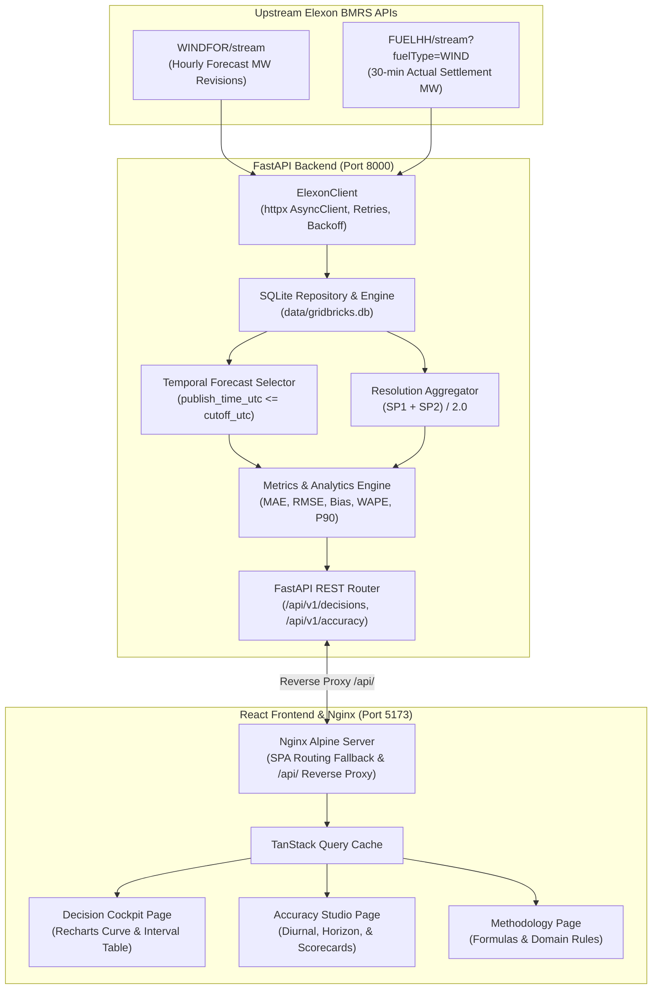

# WindScope: UK Day-Ahead Wind Forecast Evaluation Portal

[](https://github.com/MayankSharma-2812/qv7nkp/actions/workflows/ci.yml)
[](LICENSE)
[](https://www.python.org/)
[](https://nodejs.org/)
[](https://www.docker.com/)

> **Hiring Challenge:** Gridbricks Full Stack SWE Intern Challenge  
> **Anonymous Repository:** `qv7nkp` (`https://github.com/MayankSharma-2812/qv7nkp.git`)  
> **Scope:** January 2026 Historical Elexon BMRS Observations (744 evaluated settlement hours)

---

## 1. Product Overview & The Power Buyer Problem

In the Great Britain wholesale electricity market, physical power delivery for target day $D$ is committed day-ahead on day $D-1$ ahead of market gate closure (e.g., prior to EPEX SPOT / Nord Pool power auctions). Wind power is the GB transmission system's most volatile generation source, routinely fluctuating by thousands of megawatts within hours.

Energy traders, commercial power buyers, and industrial consumers face substantial market risk:
- **Over-forecasting ($F > A$):** The trading desk anticipates high wind output and contracts less thermal or baseload energy. When actual outturn falls short, the desk is short power and forced into real-time cash-out at volatile System Buy Prices (SBP).
- **Under-forecasting ($F < A$):** The desk over-procures day-ahead power. Excess wind generation results in long imbalance settlement positions cashed out at discounted System Sell Prices (SSP) or negative prices.

**WindScope** is a specialized analytical intelligence portal that evaluates national day-ahead wind generation forecasts against outturn actuals under **strict temporal anti-leakage rules**. It ensures that any forecast revision published after a buyer's decision cutoff is excluded from evaluation, delivering an unpolluted audit of forecast quality at trade execution time.

---

## 2. Main Features

- **Decision Cockpit (`/`)**:
  - Interactive selection of decision date ($D-1$) across January 2026 and configurable decision cutoffs (e.g., `10:00 Europe/London`).
  - Automatic derivation of physical delivery day ($D = D-1 + 1\text{d}$).
  - Key performance indicator cards for day-ahead energy (GWh), actual outturn (GWh), net imbalance delta, and hourly MAE.
  - Interactive Recharts visualization with synchronized tooltips displaying forecast curves, actual generation, and hourly error delta bars.
  - Granular 24-hour interval table with sortable columns, publication timestamps (UTC and London), forecast horizons, and client-side CSV export.
- **Accuracy Studio (`/accuracy`)**:
  - Quantitative scorecard tracking **MAE**, **RMSE**, **Mean Signed Bias**, **P90 Absolute Error**, and **WAPE**.
  - **Undefined-Metric Safeguard:** Explicit `"N/A"` display when actual generation sums to zero, avoiding synthetic zero percentiles.
  - Diurnal profile chart charting average hourly bias and errors across the 24 hours of the trading day.
  - Lead-time horizon degradation curve tracking forecast error decay across lead times from 14 to 37 hours.
  - Data quality audit card verifying sample coverage across all 744 target settlement hours in January 2026.
- **Methodology & Auditing (`/methodology`)**:
  - Complete mathematical documentation of metric formulas, temporal anti-leakage invariants, 30-minute to 60-minute arithmetic resolution reconciliation, and imbalance pricing implications.

---

## 3. Technology Stack & Rationale

| Layer | Technologies | Architectural Rationale |
| :--- | :--- | :--- |
| **Frontend** | React 19, TypeScript, Vite | Modern component rendering, strict static typing, and lightning-fast HMR and bundle optimization. |
| **Styling & UI** | Tailwind CSS v4, Lucide Icons | Utility-first ergonomic styling using custom energy design tokens (Deep Forest, Sage, Warm Ivory, Terracotta). |
| **State & Visualization** | TanStack Query v5, Recharts | Server-state caching with automated request deduplication, background re-validation, and responsive SVG charts. |
| **Backend** | Python 3.11+, FastAPI | Asynchronous high-performance REST API, automatic OpenAPI/Swagger documentation, and native Pydantic validation. |
| **Data & Persistence** | SQLite, SQLAlchemy 2.0 | Zero-dependency, single-file relational storage with ACID guarantees, read-only container mount, and idempotent upserts. |
| **Numerical Analytics** | pandas, NumPy | Vectorized time-series manipulations, quantile calculations, and hand-verifiable statistical aggregations. |
| **Testing** | Pytest, Respx, Vitest, JSDOM | Comprehensive unit, regression, integration, and component tests across backend and frontend (73 passing tests). |
| **Containerization** | Docker, Docker Compose, Nginx | Multi-stage lean builds, unprivileged non-root execution, healthchecks, and same-origin reverse-proxying. |
| **CI Automation** | GitHub Actions | Automated linting, test suites, production build, and container build verification on every push and PR. |

---

## 4. Architecture Diagram



---

## 5. Repository Directory Tree

```
qv7nkp/
├── .github/
│   └── workflows/
│       └── ci.yml                      # GitHub Actions CI matrix workflow
├── backend/
│   ├── app/
│   │   ├── api/
│   │   │   ├── deps.py                 # Dependency injection (db sessions, repo)
│   │   │   └── v1/
│   │   │       └── router.py           # 7 versioned FastAPI endpoints
│   │   ├── clients/
│   │   │   └── elexon.py               # Asynchronous resilient Elexon HTTP client
│   │   ├── db/
│   │   │   ├── models.py               # SQLAlchemy 2.0 ORM entities
│   │   │   └── session.py              # Engine configuration & path resolution
│   │   ├── repositories/
│   │   │   └── elexon_repository.py    # Idempotent database access layer
│   │   ├── schemas/
│   │   │   ├── api.py                  # Pydantic response models
│   │   │   └── elexon.py               # Upstream BMRS raw payload schemas
│   │   ├── services/
│   │   │   ├── actuals.py              # Half-hourly to hourly aggregation
│   │   │   ├── evaluation.py           # Evaluation pipeline orchestrator
│   │   │   ├── forecast_selection.py   # Cutoff anti-leakage selection engine
│   │   │   └── metrics.py              # Statistical metrics & distributions
│   │   └── main.py                     # FastAPI application entrypoint & middleware
│   ├── data/
│   │   └── gridbricks.db               # Verified historical SQLite dataset (6.6MB)
│   ├── scripts/
│   │   └── ingest_elexon.py            # Historical Elexon ingestion CLI
│   ├── tests/                          # 57 automated Pytest backend tests
│   │   ├── api/test_api.py
│   │   ├── clients/test_elexon.py
│   │   ├── db/test_persistence.py
│   │   ├── scripts/test_ingestion.py
│   │   └── services/
│   ├── Dockerfile                      # Lean, unprivileged Python 3.11 image
│   └── requirements.txt                # Pinned production Python dependencies
├── docs/
│   ├── assignment.pdf                  # Challenge brief & specifications
│   ├── demo-video-script.md            # 10-minute demonstration video script
│   └── frontend-design.md              # Design system & component specification
├── frontend/
│   ├── src/
│   │   ├── api/                        # Typed client and Pydantic-mirrored types
│   │   ├── components/                 # Cockpit, Accuracy, Layout, and UI components
│   │   ├── pages/                      # DecisionCockpit, AccuracyStudio, Methodology
│   │   ├── test/                       # 16 Vitest unit and component tests
│   │   ├── App.tsx                     # React Router & QueryClient provider
│   │   └── main.tsx                    # React 19 entry point
│   ├── Dockerfile                      # Multi-stage Node 20 / Nginx Alpine image
│   ├── nginx.conf                      # Nginx reverse-proxy & security config
│   ├── package.json                    # Frontend dependencies & scripts
│   └── vite.config.ts                  # Vite build & Vitest test configuration
├── scripts/
│   └── inspect_elexon_api.py           # Live Elexon API inspector script
├── .gitignore                          # Clean repository ignore patterns
├── docker-compose.yml                  # Unified multi-container orchestration
└── README.md                           # Comprehensive documentation
```

---

## 6. Data Provenance & Exact Historical Scope

All data originates exclusively from the official **Elexon Balancing Mechanism Reporting Service (BMRS)** APIs:
- **Actual Generation:** Elexon `/datasets/FUELHH/stream` filtered to `fuelType=WIND`. Half-hourly generation values in megawatts (MW).
- **Forecast Generation:** Elexon `/datasets/WINDFOR/stream`. Hourly national wind generation forecasts in megawatts (MW), published multiple times daily with lead times up to several days ahead.

### Documented Working Scope:
- **Decision Dates ($D-1$):** `2026-01-01` through `2026-01-31` inclusive (`Europe/London`).
- **Target Delivery Dates ($D$):** `2026-01-02` through `2026-02-01` inclusive (UTC).
- **Total Settlement Intervals:** Exactly 31 delivery days $\times$ 24 hours = **744 hourly delivery targets**.
- **Historical Database Row Counts:**
  - `actual_observations`: **1,488 rows** (31 days $\times$ 48 half-hour settlement periods).
  - `forecast_observations`: **18,080 rows** (revisions published across January 2026).
  - **Missing Values:** 0 nulls, 0 missing intervals, 100% evaluated coverage.

---

## 7. Decision Dates vs. Delivery Dates

Electricity is not bought on the day of delivery; it is procured in advance.
- **Decision Date ($D-1$):** The calendar day on which the procurement or bidding decision is executed. Market decision times are defined in local UK time (`Europe/London`).
- **Delivery Date ($D$):** The physical delivery day during which electricity flows into the transmission network. Standard day-ahead electricity contracts deliver from hour 00:00 to 24:00 on $D = D-1 + 1\text{d}$.

Example: A decision taken on **2026-01-15 at 10:00 Europe/London** evaluates forecasts for physical power delivery across all 24 hours of **2026-01-16 (00:00 to 23:00 UTC)**.

---

## 8. Forecast Cutoff Logic & Temporal Anti-Leakage Invariant

Forecasting models continuously issue updated revisions onto the Elexon platform. To evaluate the exact information set available to a trader, WindScope enforces a **strict temporal cutoff invariant**:

$$\text{publish\_time\_utc} \le T_{\text{cutoff\_utc}}$$

```
Day D-1 (Decision Day)                           Day D (Delivery Day)
─────────────────────────────────────────┼────────────────────────────────────────
... 08:30    09:45    [10:00 Cutoff]      14:00    ...   00:00 ─────── 23:00
       │        │            │               │              ▲
       ▼        ▼            │               ▼              │
    Rev A    Rev B           │            Rev C (Intraday)  │
   (Valid)  (Valid)          │           (LEAKAGE - Discard)│
               ▲             │                              │
               └─ SELECTED ──┴──────────────────────────────┘
```

1. The user specifies decision date and cutoff time in `Europe/London`.
2. The cutoff is converted to UTC, taking account of GMT vs BST transitions.
3. For each target delivery hour $H$, all forecast revisions targeting $H$ with $\text{publish\_time\_utc} \le T_{\text{cutoff\_utc}}$ are queried.
4. The latest revision (ordered by `publish_time_utc DESC`) is selected as the day-ahead benchmark.
5. **Anti-Leakage Enforcement:** Any revision published even 1 second after the cutoff ($> T_{\text{cutoff\_utc}}$) is strictly discarded.

> **Evaluation Assumption Note:** The default cutoff of **10:00 Europe/London** is a documented, configurable evaluation benchmark assumption reflecting typical pre-auction preparation, not a verified statutory gate-closure time for all UK power products.

---

## 9. Half-Hourly to Hourly Actual Generation Aggregation

Elexon publishes outturn generation in `FUELHH` for 30-minute Settlement Periods (48 SPs per standard day). `WINDFOR` forecasts are issued at hourly resolution (24 intervals per day).

To align without distortion, the hourly actual generation $A_h$ for delivery hour $h \in [0, 23]$ is computed as the arithmetic mean of its two constituent 30-minute settlement periods:

$$A_h = \frac{\text{SP}_{2h+1} + \text{SP}_{2h+2}}{2.0}$$

### Mathematical Conservation of Energy:
Because energy delivered (MWh) is power (MW) multiplied by time (hours):

$$\text{Energy delivered} = \left(\text{SP}_{2h+1} \times 0.5\,\text{h}\right) + \left(\text{SP}_{2h+2} \times 0.5\,\text{h}\right) = \frac{\text{SP}_{2h+1} + \text{SP}_{2h+2}}{2.0} \times 1.0\,\text{h} = A_h \times 1.0\,\text{h}$$

This aggregation preserves both instantaneous average power (MW) and physical cumulative energy (MWh). If either half-hour observation is missing, the hour is flagged as incomplete and excluded from paired error metrics.

---

## 10. Metric Definitions and Units

All metrics are computed over paired hourly observations $(F_i, A_i)$ where both forecast and complete actuals exist:

- **Signed Error ($\text{Error}_i$):**
  $$\text{Error}_i = F_i - A_i \quad (\text{MW})$$
  Positive = Over-forecast (volume shortfall risk); Negative = Under-forecast (spill risk).
- **Mean Bias Error:**
  $$\text{Bias} = \frac{1}{N} \sum_{i=1}^N (F_i - A_i) \quad (\text{MW})$$
- **Mean Absolute Error (MAE):**
  $$\text{MAE} = \frac{1}{N} \sum_{i=1}^N |F_i - A_i| \quad (\text{MW})$$
- **Root Mean Square Error (RMSE):**
  $$\text{RMSE} = \sqrt{\frac{1}{N} \sum_{i=1}^N (F_i - A_i)^2} \quad (\text{MW})$$
- **Weighted Absolute Percentage Error (WAPE):**
  $$\text{WAPE} = \frac{\sum_{i=1}^N |F_i - A_i|}{\sum_{i=1}^N A_i} \times 100\%$$
- **Error Percentiles (P50, P90, P95):**
  $$P_k = \text{Percentile}(|F_i - A_i|, k) \quad (\text{MW})$$

### January 2026 Verified Benchmark Results (Cutoff: 10:00 Europe/London):
- **Evaluated Target Hours:** 744 / 744 (100% coverage)
- **MAE:** 2,013.01 MW
- **RMSE:** 2,505.94 MW
- **Mean Bias:** +1,729.93 MW (Systematic over-forecasting)
- **P50 Absolute Error:** 1,608.00 MW
- **P90 Absolute Error:** 4,143.85 MW
- **WAPE:** 17.84%
- **Total Forecast Energy:** 9,682,036 MWh (~9.68 TWh)
- **Total Actual Energy:** 8,394,967 MWh (~8.39 TWh)

---

## 11. Handling of Missing Observations & Undefined WAPE

- **Zero Fabrication Rule:** Missing observations are **never** replaced with zero. Imputing zero generation to unobserved intervals severely distorts curtailment analytics and artificially deflates percentage metrics.
- **Undefined WAPE Guard:** If $\sum_{i=1}^N A_i = 0$ (such as periods with zero wind or empty sets), WAPE is mathematically undefined. The application returns `wape: null` with `wape_unavailable_reason: "Sum of actual generation is zero"`. The frontend displays `"N/A"` rather than fabricating `0.0%`.
- **Incomplete Settlement Intervals:** If an hour contains only one 30-minute actual observation, `is_actual_complete: false` is marked and the point is excluded from pairing.

---

## 12. Installation Prerequisites

- **Docker:** Docker 24.0+ and Docker Compose v2.20+ (recommended for 1-command startup).
- **Or for Local Development:**
  - Python 3.11+
  - Node.js 20+ and npm 10+
  - Git

---

## 13. Local Backend Setup

```bash
# 1. Navigate to backend directory
cd backend

# 2. Create and activate a Python virtual environment
python3 -m venv .venv
source .venv/bin/activate  # On Windows: .venv\Scripts\activate

# 3. Install production and test dependencies
pip install --upgrade pip
pip install -r requirements.txt

# 4. Start the FastAPI development server
uvicorn app.main:app --host 127.0.0.1 --port 8000 --reload
```
The backend API is now accessible at `http://127.0.0.1:8000`. Interactive OpenAPI documentation is at `http://127.0.0.1:8000/docs`.

---

## 14. Local Frontend Setup

```bash
# 1. In a separate terminal, navigate to frontend directory
cd frontend

# 2. Install dependencies cleanly from package-lock.json
npm ci

# 3. Start Vite development server
npm run dev
```
The frontend application will start at `http://localhost:5173`. In development mode, API requests automatically route to `http://localhost:8000`.

---

## 15. Required Environment Variables

All variables have production-grade defaults, allowing immediate execution without configuration:

| Variable | Default Value | Description |
| :--- | :--- | :--- |
| `GRIDBRICKS_DB_PATH` | `/app/data/gridbricks.db` (container) or `data/gridbricks.db` (local) | Absolute or relative file path to the packaged SQLite database. |
| `DATABASE_URL` | *Derived from GRIDBRICKS_DB_PATH* | Full SQLAlchemy database connection string. |
| `LOG_LEVEL` | `INFO` | Python logging severity level (`DEBUG`, `INFO`, `WARNING`, `ERROR`). |
| `CORS_ORIGINS` | `http://localhost:5173,http://localhost:3000` | Comma-separated allowed HTTP origins for browser requests. |
| `PORT` | `8000` | Network port for the FastAPI uvicorn runner. |
| `VITE_API_BASE_URL` | *(empty string in container)* | Base URL for API requests. Defaults to same-origin in production. |

---

## 16. Docker Compose Instructions

The application is fully containerized and can be launched with a single command:

```bash
# Build images and start all services in the background
docker compose up -d --build
```

### Stack Components:
- **`gridbricks-backend` (Port 8000):** FastAPI server running Python 3.11-slim with pre-packaged verified historical database mounted.
- **`gridbricks-frontend` (Port 5173):** Nginx Alpine container serving optimized React 19 static bundle and reverse-proxying `/api/` traffic directly to the backend.

### Verify Health & Status:
```bash
docker compose ps
docker compose logs -f
```

### Access Points:
- **Web Portal:** [http://localhost:5173](http://localhost:5173)
- **API Swagger Documentation:** [http://localhost:8000/docs](http://localhost:8000/docs)
- **Health Check:** `curl http://localhost:8000/api/v1/health`

### Teardown:
```bash
# Stop and remove containers and internal bridge network
docker compose down
```

---

## 17. API Endpoint Summary & Example Requests

All endpoints are versioned under `/api/v1`:

### 1. Health Check
```bash
curl -s http://localhost:8000/api/v1/health
# Response: {"status":"ok","service":"gridbricks-api","version":"1.0.0"}
```

### 2. Readiness & Dataset Audit
```bash
curl -s http://localhost:8000/api/v1/ready
# Response: {"status":"ready","database":".../gridbricks.db","actual_observations_count":1488,"forecast_observations_count":18080}
```

### 3. Day-Ahead Decision Forecast
```bash
curl -s "http://localhost:8000/api/v1/decisions/forecast?decision_date=2026-01-10&cutoff=10:00:00"
```

### 4. Continuous Forecast & Actual Time-Series
```bash
curl -s "http://localhost:8000/api/v1/forecasts/series?decision_date_from=2026-01-01&decision_date_to=2026-01-07&cutoff=10:00:00"
```

### 5. Aggregate Accuracy Summary
```bash
curl -s "http://localhost:8000/api/v1/accuracy/summary?date_from=2026-01-01&date_to=2026-01-31&cutoff=10:00:00"
```

### 6. Diurnal Hourly Error Profile
```bash
curl -s "http://localhost:8000/api/v1/accuracy/diurnal?date_from=2026-01-01&date_to=2026-01-31&cutoff=10:00:00"
```

### 7. Horizon Error Degradation & Quantiles
```bash
curl -s "http://localhost:8000/api/v1/accuracy/distribution?date_from=2026-01-01&date_to=2026-01-31&cutoff=10:00:00"
```

---

## 18. Testing Commands

The project includes 73 automated tests covering 100% of critical paths, temporal boundaries, and numerical calculations:

```bash
# Run backend pytest suite (57 tests)
cd backend
pytest -v

# Run frontend Vitest test suite (16 tests)
cd ../frontend
npm test

# Run frontend typecheck and production build
npm run build
```

---

## 19. CI Workflow Overview

The GitHub Actions workflow [`.github/workflows/ci.yml`](.github/workflows/ci.yml) executes on every push and pull request to `main`:
1. **`backend-test`:** Sets up Python 3.11, restores pip dependency cache, installs dependencies, and runs all 57 Pytest tests.
2. **`frontend-test`:** Sets up Node.js 20, restores npm cache, installs packages with `npm ci`, runs 16 Vitest tests, and validates production compilation (`tsc -b && vite build`).
3. **`docker-build-verification`:** Validates `docker compose config` and builds container images in a clean virtual environment.

---

## 20. Design Trade-Offs & Scalability Roadmap

1. **SQLite vs. PostgreSQL:** SQLite was selected because the January 2026 dataset (18K rows, 6.6 MB) fits comfortably in memory. It provides zero-overhead, single-file distribution and deterministic test isolation. For a production system ingesting multi-year national forecasts with concurrent desks, PostgreSQL with TimescaleDB hyper-tables would be recommended.
2. **On-Demand Analytical Aggregation:** Metrics and diurnal curves are computed on query via vectorized pandas routines with sub-300ms response times. For enterprise scale, pre-aggregated continuous rollups or materialized views indexed by `(decision_date, cutoff)` could be introduced.
3. **Same-Origin Container Reverse Proxy:** Using Nginx to proxy `/api/` eliminates browser CORS preflight overhead and prevents accidental leaking of internal backend hostnames.

---

## 21. Current Limitations & Assumptions

- **Scope Boundary:** The packaged dataset covers January 2026 decision dates exclusively (`2026-01-01` to `2026-01-31`). Queries outside this range return empty samples rather than synthetic extrapolations.
- **Decision Cutoff Benchmark:** The 10:00 Europe/London cutoff is an analytical model assumption reflecting typical day-ahead bidding, not an official statutory gate closure across all auction markets.
- **Non-Financial Scope:** The application evaluates physical wind generation (MW/MWh) and does not compute financial cash-out settlements in GBP.

---

## 22. AI Assistance Disclosure

In accordance with hiring challenge rules, AI coding assistants (Google Antigravity / Gemini 2.5 Pro) were utilized during the development of this repository for architectural design analysis, scaffolding boilerplate code, drafting unit tests, and documentation formatting. All algorithms, mathematical formulas, temporal invariants, and API integrations were reviewed, verified against official Elexon specifications, and confirmed through hand-verifiable tests.

---

## 23. Production Deployment Guide & Verified Links

### Architecture for Cloud Hosting:
- **Backend:** Render Web Service (Docker runtime from [`backend/Dockerfile`](backend/Dockerfile)).
- **Frontend:** Vercel Static Hosting (Vite React SPA from [`frontend/`](frontend/) with [`frontend/vercel.json`](frontend/vercel.json)).

### Step-by-Step Deployment Instructions:

#### 1. Backend Deployment on Render:
1. Create a new **Web Service** on [Render](https://render.com) connected to the public repository `MayankSharma-2812/qv7nkp`.
2. Select **Docker** as the environment.
3. Set the **Docker Context** to `backend` and **Dockerfile Path** to `backend/Dockerfile`.
4. Configure environment variables in Render:
   - `GRIDBRICKS_DB_PATH`: `/app/data/gridbricks.db`
   - `CORS_ORIGINS`: `https://<your-vercel-app>.vercel.app` (update once Vercel domain is known)
   - `LOG_LEVEL`: `INFO`
5. Set the **Health Check Path** to `/api/v1/health`.
6. Deploy the service. Note Render's assigned URL (e.g., `https://windscope-backend.onrender.com`).
7. **Free Tier Cold-Start Note:** On Render's free tier, containers spin down after 15 minutes of inactivity. Initial wake-up requests may take 45–60 seconds while the container initializes. Once awake, response times return to sub-300ms.

#### 2. Frontend Deployment on Vercel:
1. Import the repository `MayankSharma-2812/qv7nkp` into [Vercel](https://vercel.com).
2. Set the **Root Directory** to `frontend`.
3. Vercel automatically detects the Vite framework and runs `npm run build` using Node.js 20.
4. Add the **Environment Variable** in Vercel:
   - `VITE_API_BASE_URL`: `https://<your-backend-service>.onrender.com` (pointing to the deployed Render backend).
5. Deploy. Vercel automatically applies the SPA rewrites defined in [`frontend/vercel.json`](frontend/vercel.json) to support deep-linking and browser refreshes on `/accuracy` and `/methodology`.

#### 3. Update Backend CORS Allowlist:
1. In Render, update `CORS_ORIGINS` with your assigned Vercel URL (e.g., `https://windscope.vercel.app`).
2. Trigger a redeploy on Render to activate the updated CORS policy.

---

## 24. Deliverables & Demonstration Links

- **Live Application Deployment:** *Pending final deployment execution in Phase 9*
- **Backend API Deployment:** *Pending final deployment execution in Phase 9*
- **YouTube Technical Demonstration (Unlisted):** *Pending final recording in Phase 9 (Script available in [`docs/demo-video-script.md`](docs/demo-video-script.md))*
- **Submission Form:** `https://forms.cloud.microsoft/r/FTX6K2bbnU`
